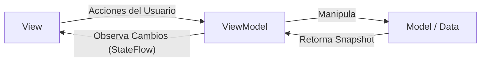

# Documentación del Proyecto: CampusFlow

## Introducción
**CampusFlow** es una aplicación móvil nativa para Android diseñada para centralizar y optimizar la vida académica de los estudiantes universitarios. Surge de la necesidad de contar con una herramienta unificada que permita gestionar tareas, consultar el horario de clases, realizar simulaciones de calificaciones y recibir avisos institucionales de manera rápida y segura, apoyándose en la nube.

---

## 1. Descripción de la Organización
El proyecto está enfocado para su uso dentro de una Institución de Educación Superior (Universidad Tecnológica). Esta institución atiende a cientos de estudiantes que cursan diversas ingenierías y licenciaturas, quienes requieren un canal de comunicación oficial, directo y herramientas digitales que faciliten su autogestión académica.

## 2. Planteamiento del Problema
Actualmente, los estudiantes universitarios manejan múltiples fuentes de información de forma dispersa: plataformas de tareas, hojas de cálculo para calificaciones y redes sociales para avisos institucionales. Esta fragmentación genera desorganización, pérdida de fechas de entrega y desinformación sobre comunicados importantes, afectando el rendimiento académico y la comunicación con la institución.

## 3. Objetivo General
Desarrollar una aplicación móvil integral para dispositivos Android que centralice la gestión académica del estudiante, integrando módulos de tareas, horarios y comunicados oficiales, utilizando servicios en la nube para garantizar disponibilidad y sincronización en tiempo real.

### 3.1. Objetivos específicos
1. Implementar un sistema de Autenticación seguro mediante correo y contraseña, incluyendo recuperación de clave.
2. Desarrollar un gestor de tareas privado y personalizado utilizando el método Kanban.
3. Construir un módulo de Horarios de Clases personalizado para alumnos y un Directorio de Profesores para administradores, con un Simulador de Calificaciones interactivo y validado.
4. Integrar un portal de Avisos Institucionales con notificaciones en tiempo real, filtrado por categorías, posibilidad de eliminación y roles de acceso (Administrador/Estudiante).
5. Diseñar una interfaz gráfica fluida y moderna utilizando el estilo visual Glassmorphism, temas dinámicos (Oscuro/Claro), animaciones Lottie y transiciones de pantalla avanzadas.

## 4. Justificación del Proyecto
CampusFlow soluciona el problema de fragmentación integrando las funciones académicas más críticas en un solo entorno de bolsillo. La aplicación no solo mejora la organización del alumno, sino que proporciona a los administrativos un canal directo e infalible para publicar avisos, mejorando la comunicación institucional global y promoviendo el éxito estudiantil.

## 5. Alcances y limitaciones
**Alcances:**
* La aplicación funcionará nativamente en dispositivos Android (API 24 en adelante).
* Sincronización en tiempo real de avisos, horarios y tareas mediante Firestore.
* Persistencia de datos locales implícita mediante caché persistente offline.
* Carga y codificación de imagen de perfil en formato Base64 sin depender de servidores de almacenamiento de pago.

**Limitaciones:**
* En esta primera etapa no se desarrollará una versión para iOS.
* El rol de Administrador se activa mediante la verificación del dominio de correo institucional (`@admin.ut.edu.mx`).

## 6. Marco Teórico
Para el desarrollo de la aplicación se utilizan las siguientes tecnologías, conceptos y herramientas:
*   **Kotlin:** Lenguaje de programación moderno, multiparadigma y estáticamente tipado, recomendado oficialmente por Google para Android.
*   **Jetpack Compose:** Kit de herramientas moderno y declarativo de UI para Android.
*   **Firebase Authentication & Cloud Firestore:** Servicios Backend-as-a-Service (BaaS) para la gestión de identidades y base de datos NoSQL en tiempo real.
*   **Coil (Coroutine Image Loader):** Librería para la carga rápida y eficiente de imágenes nativas en Jetpack Compose.
*   **Codificación Base64 (Texto-Imagen):** Técnica de optimización que convierte archivos binarios (imágenes comprimidas a 256x256) a texto plano para su almacenamiento en Firestore.
*   **Lottie:** Librería de renderizado de animaciones vectoriales JSON creadas en Adobe After Effects.
*   **Glassmorphism:** Tendencia de diseño basada en desenfoques de fondo, transparencias y bordes sutiles para simular cristal.
*   **Material Design 3 (M3):** Lenguaje de diseño oficial de Android para componentes estructurales y de navegación.
*   **Android Studio & Gradle:** Entorno de desarrollo integrado (IDE) oficial y su sistema de automatización de compilación.
*   **Git & GitHub:** Sistema de control de versiones distribuido y plataforma de alojamiento de código.

## 7. Desarrollo

### 7.1. Plan del proceso de desarrollo móvil (Metodología Ágil)
Se utilizó **Scrum** como metodología ágil. El desarrollo se dividió en Sprints de 1 a 2 semanas:
*   **Sprint 1:** Configuración de Firebase, reglas de base de datos y arquitectura de 3 capas.
*   **Sprint 2:** Desarrollo del Gestor de Tareas privadas y navegación principal con animaciones.
*   **Sprint 3:** Desarrollo del módulo de Horarios (Estudiantes/Admins) y Simulador de calificaciones con validación.
*   **Sprint 4:** Módulo de Avisos con borrado y filtros, notificaciones locales de tiempo real, avatar en Base64, cambio de tema (Oscuro/Claro) y documentación final.

### 7.2. Justificación de la arquitectura
Para el desarrollo de este software se seleccionó la **Arquitectura de N-Capas (específicamente la Arquitectura de 3 Capas)**. Esta arquitectura estructura el software de manera lógica y física, separando responsabilidades:
1.  **Capa de Presentación (UI Layer):** Es la capa superior. Interactúa directamente con el usuario mediante Jetpack Compose, componentes `liquidGlass` y animaciones de `Lottie`.
2.  **Capa de Lógica de Negocio (Business Logic Layer - BLL):** Es la capa intermedia. Aquí se procesan las reglas de la aplicación, como la validación de rango (0-100) en el simulador, el filtrado de permisos de administrador (`@admin.ut.edu.mx`), las transiciones de autenticación y la codificación/decodificación de imágenes en Base64.
3.  **Capa de Acceso a Datos (Data Access Layer - DAL):** Es la capa inferior. Se encarga de guardar, modificar, borrar y recuperar la información desde Firebase Firestore (en las colecciones `tasks`, `subjects`, `notices` y `users`), abstrayendo a las demás capas de la red.

### 7.3. Diagrama de la arquitectura
A continuación, se presenta la figura que esquematiza la Arquitectura de N-Capas (3 Capas) implementada:

```mermaid
graph TD
  subgraph Capa de Presentación (UI)
    A[Pantallas Compose, Modales Glassmorphism y Animaciones Lottie]
  end
  subgraph Capa de Lógica de Negocio (BLL)
    B[ViewModels, Validaciones 0-100, Permisos de Admin y Conversión Base64]
  end
  subgraph Capa de Acceso a Datos (DAL)
    C[Firebase Firestore SDK, Caché Persistente y Auth]
  end

  A -->|Envía peticiones| B
  B -->|Solicita / Actualiza datos| C
  C -->|Retorna información| B
  B -->|Envía estados a la vista| A
```

### 7.4. Propuesta de los patrones de diseño
Dentro de la arquitectura mencionada, se utilizaron patrones de diseño específicos a nivel de código para resolver problemas recurrentes:

**1. Patrón MVVM (Model-View-ViewModel):**
Es el patrón de diseño principal utilizado para comunicar la Capa de Presentación con la Capa de Negocio. El *ViewModel* expone el estado de la vista de forma observable.
*Figura del Patrón de Diseño MVVM:*


**2. Patrón Observer (Observador):**
Implementado mediante `StateFlow` de Kotlin. Permite que la interfaz de usuario observe pasivamente un flujo de datos y se redibuje automáticamente cuando la información en el ViewModel cambia (como la llegada de un nuevo aviso o la detección del modo oscuro/claro).

**3. Patrón Singleton:**
Garantiza que exista una única instancia global de la conexión a la base de datos (`FirebaseFirestore.getInstance()`) y del estado del tema global.

### 7.5. Justificación de los frameworks de desarrollo móvil a utilizar
Se utilizó **Android SDK nativo** con el framework **Jetpack Compose**. Compose reduce el código *boilerplate* al evitar el uso de archivos XML, permitiendo construir componentes personalizados con efectos `liquidGlass` y animaciones integradas en tiempo récord.

### 7.6. Esquema de pruebas
*   **Pruebas Manuales / UI:** Se realizaron pruebas en el emulador de Android Studio y en dispositivos físicos reales, validando la responsividad y usabilidad.
*   **Pruebas de Integración:** Pruebas controladas del flujo de login, registro, recuperación de clave, subida de avatar en Base64, persistencia offline y verificación de permisos entre los roles de Administrador (`@admin.ut.edu.mx`) y Estudiante.

### 7.7. Estrategia de versionamiento
Se emplea **Git** para el control de versiones local y **GitHub** como repositorio remoto, siguiendo un flujo basado en *Feature Branching*.

### 7.8. Mecanismos de seguridad
*   **Autenticación Cifrada:** El acceso está respaldado por Firebase Auth y permite recuperación de clave por correo.
*   **Aislamiento Privado de Datos:** Las lógicas de consulta (`whereEqualTo("userId", currentUserId)`) aseguran que las tareas y horarios pertenezcan únicamente al estudiante autenticado.
*   **Autorización de Roles Cifrada:** Los permisos de creación/borrado de avisos y visualización de directorio docente se validan estrictamente si el correo del usuario verificado termina en `@admin.ut.edu.mx`.

### 7.9. API’s propias o de terceros
*   **Firebase Authentication API:** Gestión de inicio de sesión y reseteo de clave.
*   **Cloud Firestore API:** Lectura, escritura, borrado y sincronización en tiempo real.
*   **Lottie Animation API:** Renderizado de estados vacíos.
*   **Coil Image Loader API:** Renderizado eficiente de imágenes y bitmaps.

### 7.10. Servicios en la nube
El backend es 100% *Serverless* soportado por **Google Cloud (Firebase)**, garantizando disponibilidad, reglas de seguridad activas (`allow read, write: if true;`) y almacenamiento distribuido.

### 7.11. Enlace del repositorio en funcionamiento
*(Coloca aquí el enlace real a tu repositorio público de GitHub. Ejemplo: https://github.com/tu-usuario/CampusFlow)*

## 8. Conclusiones
1. **Se implementó** un sistema de Autenticación seguro mediante correo y contraseña, incluyendo la funcionalidad de recuperación de clave vía correo electrónico.
2. **Se desarrolló** un gestor de tareas privado y personalizado utilizando el método Kanban con aislamiento de datos por usuario.
3. **Se construyó** el módulo de Horarios de Clases adaptativo (Directorio para profesores / Agenda para alumnos) y **se integró** el Simulador de Calificaciones con validación estricta de rangos (0-100).
4. **Se integró** el portal de Avisos Institucionales con notificaciones emergentes (Snackbar) en tiempo real, filtros dinámicos por categoría, borrado de comunicados y control de roles mediante el dominio `@admin.ut.edu.mx`.
5. **Se diseñó** una interfaz gráfica altamente moderna aplicando *Glassmorphism*, fondos líquidos animados en tiempo real, alternancia de tema Oscuro/Claro dinámico, avatares guardados mediante codificación Base64 en Firestore y animaciones vectoriales de Lottie.

## 9. Bibliografía
1. Google. (2026). *Jetpack Compose Documentation*. Android Developers. https://developer.android.com/jetpack/compose
2. Firebase. (2026). *Cloud Firestore Documentation*. Google Firebase. https://firebase.google.com/docs/firestore
3. Martin, R. C. (2017). *Clean Architecture: A Craftsman's Guide to Software Structure and Design*. Prentice Hall.
4. Erich Gamma et al. (1994). *Design Patterns: Elements of Reusable Object-Oriented Software*. Addison-Wesley.
5. Airbnb. (2026). *Lottie Docs*. LottieFiles. https://airbnb.io/lottie/#/